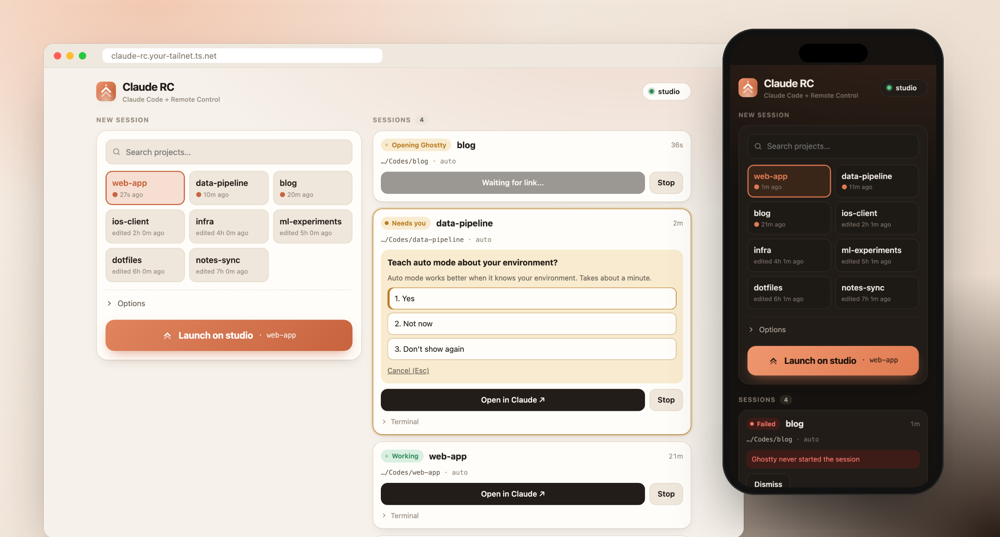

# Claude RC Launcher

**Tap a button on your phone, and a Claude Code session starts on your Mac with Remote Control already on.** Pick a project, tap Launch, then carry on in the Claude app or at claude.ai/code. Your phone becomes the place you *start* sessions too, not only where you continue them.

- **One tap.** The page remembers your most recent project, so relaunching it is a single tap. Add it to your home screen and it opens like an app.
- **Your choice of model, permission mode and conversation.** Pick the model (or keep your default) and the permission mode. Then start a new conversation, continue the last one, or pick any earlier conversation in that folder to resume.
- **A scratch folder for quick questions.** `tmp` is always first in the list. It opens a session in `/tmp/temp` (created on demand) when the task isn't tied to a project.
- **Sessions that can actually touch your files.** Every session runs inside Ghostty in the Mac's desktop session, so it inherits Ghostty's privacy permissions (Full Disk Access, external drives) and the unlocked login keychain. A session started over SSH gets neither: macOS refuses `~/Documents` and external volumes, and the keychain stays locked.
- **Answers the prompts a phone can't.** The folder-trust question is accepted for you. Any other menu Claude Code shows in the terminal, such as the auto-mode onboarding, appears on the page as buttons.
- **See everything at a glance.** Each session card shows its state (opening, ready, working, needs you, exited), opens the session in Claude, stops it, and shows the last lines of the terminal. The card also gives you the `ssh … tmux attach` command for when you want the real TUI.
- **Private by default.** The launcher is reachable only on your tailnet, accepts only the Tailscale identities you list, and refuses cross-site requests.

## How it works

```
phone / laptop browser
  └─ https://claude-rc.<tailnet>.ts.net        tailscale serve (Tailscale Service), tailnet only
       └─ rc_launcher.py on 127.0.0.1:8795     LaunchAgent in your GUI session, Python stdlib only
            └─ open -na Ghostty.app --args … -e tmux -L claude-rc new-session -s rc-<name> run.sh
                 └─ caffeinate claude --remote-control=<name> --permission-mode auto [--model opus]
                                         [--continue | --resume <id>] "<first message>"
```

Each launch opens its own Ghostty instance, and that window starts a tmux session on a dedicated socket. Because the tmux server is always born inside Ghostty, every session keeps Ghostty's TCC context. The daemon itself only runs tmux *client* commands (`list-sessions`, `capture-pane`, `send-keys`, `kill-session`), which is how it reads state, picks up the Remote Control link, and answers menus. Closing a Ghostty window doesn't end the session. A Ghostty instance whose session has ended is reaped automatically.

## Requirements

- A Mac that stays logged in to its desktop, such as a Mac mini acting as a server.
- [Claude Code](https://docs.claude.com/en/docs/claude-code), logged in with a Claude plan that includes Remote Control.
- [Ghostty](https://ghostty.org), tmux and [uv](https://docs.astral.sh/uv/): `brew install --cask ghostty && brew install tmux uv`
- [Tailscale](https://tailscale.com), to reach the page from your phone. A tagged host is needed for Tailscale Services.

## Install

On the Mac that will run the sessions:

```bash
git clone https://github.com/StevenLi-phoenix/claude-rc-launcher ~/Codes/claude-rc-launcher
cd ~/Codes/claude-rc-launcher
RC_LAUNCHER_ALLOWED_LOGINS=you@example.com \
RC_LAUNCHER_PUBLIC_HOSTS=claude-rc.your-tailnet.ts.net \
scripts/install.sh
```

The installer:
1. creates a Python environment with uv;
2. makes sure **Ghostty has Full Disk Access**. It has Ghostty read a file only Full Disk Access can read, which puts Ghostty in the list. It then opens *System Settings → Privacy & Security → Full Disk Access* for you and checks again once you switch it on;
3. writes and loads a LaunchAgent;
4. checks that the daemon answers.

Run it again whenever you update the code. `scripts/install.sh --uninstall` removes the LaunchAgent and leaves running sessions alone.

### Put it on your tailnet

With [Tailscale Services](https://tailscale.com/docs/features/tailscale-services), the page gets its own name:

1. In the admin console, open **Services** and create `claude-rc` with endpoint `tcp:443`.
2. Let your Mac host it. Either approve the host on the service page, or add an auto-approver to the policy file: `"autoApprovers": { "services": { "svc:claude-rc": ["tag:server"] } }`.
3. On the Mac:
   ```bash
   tailscale serve --bg --service=svc:claude-rc --https=443 http://127.0.0.1:8795
   tailscale serve advertise svc:claude-rc
   ```

Without Services, use a port on the machine's own name instead: `tailscale serve --bg --https=8443 http://127.0.0.1:8795`. Then set `RC_LAUNCHER_PUBLIC_HOSTS=<machine>.<tailnet>.ts.net:8443`.

Then open the URL on your phone and use **Share → Add to Home Screen**.

## Configuration

Set these when you run `scripts/install.sh`; they are written into the LaunchAgent.

| Variable | Default | Meaning |
|---|---|---|
| `RC_LAUNCHER_ALLOWED_LOGINS` | *(any)* | Comma-separated Tailscale logins allowed in. `tailscale serve` sends the `Tailscale-User-Login` header. Set it. |
| `RC_LAUNCHER_PUBLIC_HOSTS` | *(any)* | Host names the page is served under. Requests for other hosts are refused, which blocks DNS rebinding. |
| `RC_LAUNCHER_ROOTS` | `~/Codes` | Colon-separated folders whose subfolders are offered as projects. Symlinked subfolders work. |
| `RC_LAUNCHER_DEFAULT_MODE` | `auto` | Default permission mode: `auto`, `acceptEdits`, `plan`, `bypassPermissions`, `manual`. |
| `RC_LAUNCHER_MODELS` | `fable,opus,sonnet,haiku` | Models offered next to "default" (your Claude Code setting). Any `--model` alias or full name. |
| `RC_LAUNCHER_SCRATCH` | `/tmp/temp` | Scratch folder pinned first as `tmp`, created on demand. Set it empty to hide it. |
| `RC_LAUNCHER_HOST_LABEL` | short hostname | Machine name shown in the header and used in the attach command. |
| `RC_LAUNCHER_PORT` | `8795` | Local port. |
| `RC_LAUNCHER_LABEL` | `app.claude-rc-launcher` | LaunchAgent label. |

Logs go to `~/Library/Logs/claude-rc-launcher/`, and session state lives in `~/.claude-rc-launcher/`.

## One tap from the Action button

To skip the page, make an iOS Shortcut with a single **Get Contents of URL** action:

- URL: `https://claude-rc.your-tailnet.ts.net/api/start`, method **POST**
- Headers: `Content-Type: application/json`, `X-RC-Launcher: 1`
- Request body (JSON): `dir` = `/Users/you/Codes/your-project` (optional: `prompt`, `mode`, `model`, `continue`, `resume`, `name`)

Then assign the shortcut to the Action button or a widget.

## API

| Method | Path | Body | |
|---|---|---|---|
| GET | `/api/projects` | | Projects (scratch first, then most recently launched), modes, models |
| GET | `/api/conversations?dir=<path>` | | Earlier conversations in that folder: id, title, last prompt, time |
| GET | `/api/sessions` | | Sessions with state, Remote Control link, pending menu, terminal tail |
| POST | `/api/start` | `{dir, prompt?, mode?, model?, continue?, resume?, name?}` | Opens a session; `resume` takes a conversation id |
| POST | `/api/sessions/<name>/answer` | `{option: n}` or `{escape: true}` | Picks a menu option |
| POST | `/api/sessions/<name>/stop` | | Ends the session; the transcript stays, so `continue` resumes it |
| GET | `/healthz` | | Liveness, no auth |

POST requests must send `Content-Type: application/json` and `X-RC-Launcher: 1`. A browser can only add that header on a same-origin request, so other sites can't start sessions through your browser.

## Troubleshooting

- **Failed: "Ghostty never started the session".** Something on the Mac's screen is blocking Ghostty, usually a first-launch or permission dialog. Open the Mac's screen once (Screen Sharing or similar), then re-run `scripts/install.sh`.
- **Needs login.** Run `claude` once on the Mac and log in.
- **Files or external drives are refused inside a session.** Ghostty lacks Full Disk Access. Re-run the installer and switch Ghostty on in the pane it opens.
- **The page doesn't load on the tailnet.** Check `tailscale serve status` on the Mac. With Tailscale Services, also check that the Mac is approved as a host for the service.

## Development

```bash
uv venv --python 3.13 && source .venv/bin/activate && uv pip install pytest ruff
pytest -q                 # unit + integration tests (fake tmux/open, real HTTP server)
scripts/demo.py           # the page with made-up sessions on http://127.0.0.1:8796/ (?lang=en|zh)
```

## License

MIT
